# Portafolio estático en Azure con Terraform

Web estática de portafolio (tarjeta de presentación) alojada en una **Azure Storage Account** con la
función **static website**, creada íntegramente con **Terraform**. Es un proyecto de aprendizaje: cada
archivo está comentado y cada concepto explicado.

> Estado: ✅ Fase 1 · ✅ Fase 2 · ✅ Fase 3 · 🔄 Fase 4 (CI/CD)

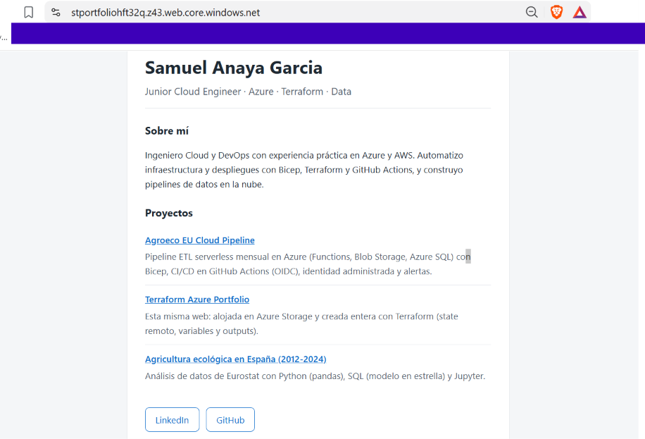

---

## Arquitectura

```
  Tu PC (PowerShell)
  ┌──────────────────────────────┐
  │ bootstrap/  (state LOCAL)    │──1) crea una vez──┐
  │ raíz ./     (state REMOTO)   │──2) plan/apply ──┐│   usa tu sesión de "az login"
  └──────────────────────────────┘                  ││
                                                    ▼▼
  ┌───────────────────────────────────────────────────────────────────┐
  │ Suscripción de Azure · región spaincentral                        │
  │                                                                   │
  │  rg-portfolio-tfstate                (creado por bootstrap/)      │
  │   └── stportfoliotfsXXXXXX  (Storage LRS, versionado, privada)    │
  │         └── contenedor tfstate                                    │
  │               └── portfolio-dev.tfstate  ◄── state de la web      │
  │                                              (con bloqueo/lease)  │
  │                                                                   │
  │  rg-portfolio-dev                    (creado por la raíz ./)      │
  │   └── stportfolioXXXXXX  (Storage Account, Standard LRS)          │
  │         └── Static website: ON                                    │
  │               └── contenedor $web                                 │
  │                     ├── index.html                                │
  │                     ├── 404.html                                  │
  │                     └── estilos.css                               │
  └──────────────────────────────┬────────────────────────────────────┘
                                 │ HTTPS público
                                 ▼
        https://stportfolioXXXXXX.zNN.web.core.windows.net
                          ▲
                    Visitante (navegador)
```

### CI/CD con GitHub Actions (Fase 4)

```
  git push (cualquier rama)
        │
        ▼
  GitHub Actions ──────────────────────────────────────────────────────────────┐
   ├─ validar   fmt -check · validate                  (no toca Azure)         │
   ├─ plan      environment: plan  ─┐                                          │
   └─ apply     environment: dev   ─┤ solo main · ⏸ espera aprobación          │
                                    │                                          │
                                    │ 1) token OIDC firmado por GitHub         │
                                    │    subject: repo:…:environment:plan|dev  │
                                    ▼                                          │
  Entra ID: App registration "sp-portfolio-github-actions"                     │
    └─ credenciales federadas (plan, dev) → comprueba issuer+audience+subject  │
                                    │ 2) token de Azure de corta duración      │
                                    ▼                                          │
  Azure RBAC:  Contributor ─────────────► rg-portfolio-dev                     │
               Storage Blob Data Contrib. ► stportfoliotfsXXXXXX (state) ◄─────┘
```

Sin contraseñas: GitHub solo guarda IDs (client, tenant, suscripción) como Secrets para que salgan
como `***` en los logs.

---

## Estructura

```
.
├── .github/workflows/
│   └── terraform.yml          # CI/CD: validar, plan y apply (con aprobación)
├── bootstrap/                 # configuración aparte (state local)
│   ├── providers.tf           # azurerm, random y azuread
│   ├── variables.tf
│   ├── main.tf                # Storage del state + tu rol RBAC
│   ├── github_oidc.tf         # identidad de GitHub: app, SP, credenciales federadas, roles
│   └── outputs.tf
├── providers.tf               # versión de Terraform y providers
├── backend.tf                 # dónde se guarda el state (Azure Storage)
├── variables.tf               # variables de entrada (con descripción y validación)
├── locals.tf                  # valores calculados: nombres, etiquetas comunes
├── main.tf                    # recursos de Azure de la web
├── outputs.tf                 # valores de salida (URL de la web...)
├── terraform.tfvars.example   # ejemplo de valores (el terraform.tfvars real no se sube)
├── .terraform.lock.hcl        # versiones exactas de los providers (sí se sube)
├── web/                       # index.html, 404.html, estilos.css
├── docs/capturas/             # capturas de pantalla
├── .gitignore
├── CLAUDE.md
└── README.md
```

---

## Conceptos de Terraform aprendidos

### Fase 1 – Lo básico

| Concepto | Explicación sencilla |
|---|---|
| **IaC** | Infraestructura descrita en archivos de texto, versionable en Git y repetible. |
| **HCL** | El lenguaje de Terraform: bloques `tipo "etiqueta" { clave = valor }`. |
| **Provider** | Plugin que traduce tu código a llamadas a la API de una nube (`azurerm` para Azure). |
| **required_version / required_providers** | Fijan qué versiones se pueden usar, para que el código no se rompa con actualizaciones. |
| **.terraform.lock.hcl** | Apunta la versión *exacta* de cada provider descargado (aquí azurerm 4.81.0). Se sube a Git. |
| **Resource** | Un recurso real (RG, Storage, blob...): `resource "TIPO" "NOMBRE_LOCAL"`. |
| **Referencias y dependencias** | `azurerm_resource_group.main.name` usa un atributo de otro recurso, y Terraform deduce el orden de creación. `depends_on` fuerza una dependencia que no se ve en el código. |
| **Funciones** | `filemd5()` calcula la huella de un archivo; si cambia, Terraform vuelve a subirlo. |
| **State** | `terraform.tfstate`: la "memoria" de Terraform. Relaciona el código con los recursos reales. Contiene datos sensibles (por ejemplo, la clave de la Storage), no se edita a mano ni se sube a Git. |
| **init / plan / apply / destroy** | Preparar · ver cambios · aplicar · borrar todo. |
| **Símbolos del plan** | `+` crear · `~` modificar · `-/+` reemplazar (borrar y crear) · `-` destruir. |
| **ForceNew** | Atributos que el provider no puede cambiar en un recurso existente. Cambiarlos obliga a reemplazarlo (`# forces replacement`). |
| **Deprecations** | Los providers avisan de atributos obsoletos antes de eliminarlos en la siguiente versión mayor. Hay que corregirlos a tiempo. |

### Fase 2 – Ordenarlo

| Concepto | Explicación sencilla |
|---|---|
| **variable** | Parámetro de entrada (`var.nombre`) con `type`, `description` y `default` opcional. Sin `default` es obligatoria. |
| **validation** | Regla que se comprueba antes de tocar Azure, con un mensaje de error propio. Usa `can(regex(...))` y `contains(...)`. |
| **terraform.tfvars** | Archivo con los valores de las variables; se lee automáticamente. Se sube solo el `.example`. |
| **Prioridad de valores** | `default` < `TF_VAR_x` < `terraform.tfvars` < `*.auto.tfvars` < `-var` / `-var-file` (gana el último). |
| **locals** | Valores calculados internos (`local.nombre`) para no repetir: nombres, etiquetas, IDs. |
| **merge()** | Une mapas. Si una clave se repite gana el último mapa; así las etiquetas fijas no se pueden pisar. |
| **output** | Valor que Terraform devuelve tras el apply (la URL). Se consulta con `terraform output`. |
| **terraform console** | Consola para evaluar expresiones (`local.x`, `upper(var.y)`) con los valores reales, sin cambiar nada. |
| **Refactorizar sin cambios** | Reorganizar el código manteniendo los mismos valores debe dar "No changes": es la prueba de que no has roto nada. |

### Fase 3 – El estado remoto

| Concepto | Explicación sencilla |
|---|---|
| **Remote backend** | El state se guarda en un blob de Azure Storage en vez de en tu PC: no se pierde y lo pueden usar otras personas o un pipeline. |
| **Bloqueo (state locking)** | Durante `plan`/`apply`, Terraform pone un *lease* sobre el blob; un segundo `apply` a la vez falla en vez de corromper el state. |
| **Huevo y gallina** | La Storage del state debe existir antes del `init`. Se crea con una configuración aparte (`bootstrap/`) cuyo state se queda en local. |
| **Backend sin variables** | El bloque `backend` se lee en `init`, antes que todo lo demás: sus valores se escriben a mano. |
| **`terraform init -migrate-state`** | Copia el state actual al nuevo backend. |
| **data source** | Bloque `data` que *lee* algo que ya existe sin crearlo (aquí, quién soy: `azurerm_client_config`). |
| **lifecycle / prevent_destroy** | Seguro que hace fallar cualquier plan que intente borrar ese recurso. |
| **use_azuread_auth + RBAC** | El backend entra con tu identidad de Entra ID y el rol *Storage Blob Data Contributor*, no con la clave de la cuenta. |
| **Versionado de blobs** | Azure guarda las versiones anteriores del state; si algo se rompe, se puede volver atrás. |
| **Drift** | Diferencia entre el código/state y la realidad (un cambio hecho a mano). `terraform plan` la detecta y propone revertirla. |
| **`-refresh-only`** | Muestra (y, si aplicas, acepta en el state) solo el drift, sin cambiar recursos. |

### Fase 4 – CI/CD con GitHub Actions y OIDC

| Concepto | Explicación sencilla |
|---|---|
| **Provider azuread** | Gestiona identidades de Entra ID (aplicaciones, service principals) a través de Microsoft Graph. |
| **App registration + service principal** | La "cuenta de servicio" de GitHub en Azure: la app es la definición y el SP la instancia a la que se dan roles. |
| **OIDC / credencial federada** | Azure confía en tokens firmados por GitHub si `issuer`, `audience` y `subject` coinciden. No hay contraseñas que guardar ni que caduquen. |
| **Subject** | Identifica quién pide el token: `repo:<usuario>/<repo>:environment:<env>`. GitHub puede usar IDs inmutables (`usuario@id/repo@id`). Debe coincidir carácter a carácter. |
| **GitHub Environments** | Agrupan reglas: solo rama `main` y *required reviewers* (aprobación manual) para `dev`. Además, dan un subject estable sin depender de la rama. |
| **Mínimo privilegio** | Contributor solo sobre el RG de la web; Storage Blob Data Contributor solo sobre la Storage del state. |
| **`resource_provider_registrations = "none"`** | Evita que el provider intente registrar servicios a nivel de suscripción, para lo que la identidad de CI no tiene permisos. |
| **`sensitive = true` (outputs)** | Oculta el valor en plan/apply; se lee a propósito con `terraform output -raw`. |
| **`TF_VAR_*` en CI** | En el pipeline no hay `terraform.tfvars`: las variables obligatorias se pasan como variables de entorno. |
| **`fmt -check` / `validate`** | Controles de calidad que no necesitan Azure y paran el pipeline antes de tocar nada. |
| **`concurrency` + `-lock-timeout`** | Dos barreras contra ejecuciones simultáneas: la cola de GitHub y el lease del state. |
| **`.terraform.lock.hcl` multiplataforma** | `terraform providers lock -platform=...` registra los hashes de Windows y Linux para que el runner de GitHub verifique los mismos providers. |

---

## Resultados de los experimentos

### Fase 1

| Experimento | Cambio | Resultado del plan | Por qué |
|---|---|---|---|
| **A** | Etiqueta `entorno`: `dev` → `desarrollo` | `~ update in-place` · `0 to add, 2 to change` (RG y Storage) | Azure permite cambiar etiquetas de un recurso existente: el recurso se mantiene, con el mismo ID. |
| **B** | Texto de `web/index.html` | `-/+ must be replaced` en el blob · `content_md5 # forces replacement` | El provider no edita blobs: borra el blob y sube uno nuevo. Es inofensivo (segundos), pero es un reemplazo. |
| **C** | Replicación `LRS` → `ZRS` (**no aplicado**) | `-/+ must be replaced` · `2 to add, 2 to destroy` (Storage y static website) | Pasar a ZRS reparte los datos físicamente en 3 zonas. Azure lo hace con una migración, no con un simple cambio de propiedad, así que el provider lo trata como borrar la cuenta (y sus datos) y crear otra. LRS → GRS, en cambio, sería in-place. |

Detalle importante del experimento C: el plan **no mostraba los blobs**, aunque al borrar la cuenta se habrían
perdido, porque los blobs apuntaban a la cuenta por su *nombre*, que no cambiaba. Desde la Fase 2 los blobs
usan `storage_container_id` (derivado del *ID* de la cuenta), así que un reemplazo de la cuenta también se
mostraría en los blobs.

**Lección:** antes de cada apply, busca `forces replacement` en el plan.

### Fase 2

| Experimento | Cambio | Resultado | Qué demuestra |
|---|---|---|---|
| **Refactorización** | Valores fijos → variables + locals, y blobs con `storage_container_id` | Solo `Changes to Outputs` (3 outputs nuevos), 0 cambios en recursos, sin avisos `deprecated` | Se puede reorganizar el código sin tocar la infraestructura si los valores finales son idénticos. |
| **A** | `entorno = "produccion"` y `prefijo = "Port-folio"` | El plan se para con los mensajes de `error_message`, **antes de conectarse a Azure** | Las validaciones atrapan errores pronto, sin coste ni riesgo. |
| **B** | Sin `terraform.tfvars` | Terraform pide `var.entorno` y `var.prefijo` por consola mostrando su `description`; con los valores a mano, `No changes` | Una variable sin `default` es obligatoria; el tfvars evita escribirla cada vez. |
| **C** | `etiquetas_extra = { propietario = ... }` y luego `{ entorno = "pirata" }` | `propietario`: `~ update in-place`. `entorno = "pirata"`: la etiqueta **no cambia** (deshecho después) | En `merge()` gana el último mapa: las etiquetas fijas van al final y no se pueden pisar. |
| **D** | `terraform console` | `local.etiquetas_comunes`, `local.nombre_grupo_recursos` y `upper(var.prefijo)` devuelven los valores calculados | Se pueden probar expresiones con datos reales sin cambiar nada. |

### Fase 3

| Experimento | Qué se hizo | Resultado | Qué demuestra |
|---|---|---|---|
| **Bootstrap** | `terraform apply` en `bootstrap/` | `5 added` (RG, random, Storage, contenedor, role assignment); el `data` source no cuenta como recurso | La Storage del state se crea aparte, con su propio state local. |
| **Migración** | `terraform init -migrate-state` y respuesta `yes` | State copiado al blob `portfolio-dev.tfstate`; `state list` muestra los 7 recursos y `plan` da `No changes` | Cambiar de backend no toca la infraestructura, solo dónde vive el state. |
| **State local retirado** | `terraform.tfstate` local movido fuera del proyecto | `plan` sigue en `No changes` | Terraform ya lee el state desde Azure, no desde el disco. |
| **Drift** | En el portal: tag `manual = si`, *Error document path* → `error.html` y borrado de `index.html` | `plan -refresh-only` lista los cambios hechos fuera de Terraform; `plan` propone `1 to add, 2 to change`; `apply` lo revierte todo | Terraform compara la realidad con el código y propone volver al código: el blob borrado se recrea (`+`) y las tags y el static website se corrigen in-place (`~`). |
| **Bloqueo** | `terraform apply` sin responder `yes` + un segundo `terraform plan` en otra ventana | El blob queda en *Lease state: Leased* y el segundo plan da `Error acquiring the state lock`; al responder `yes`, vuelve a *Available* | El lease del backend impide que dos operaciones escriban el state a la vez. |

---

## Comandos usados (PowerShell)

```powershell
# Autenticación y suscripción (el ID solo vive en la variable de entorno, nunca en el código)
az login
az account show --output table
$env:ARM_SUBSCRIPTION_ID = az account show --query id --output tsv

# Ciclo de Terraform
terraform init
terraform fmt
terraform validate
terraform plan -out fase1.tfplan
terraform apply fase1.tfplan

# Inspeccionar el state
terraform state list
terraform state show azurerm_storage_account.web

# Fase 2: variables y outputs
Copy-Item terraform.tfvars.example terraform.tfvars
terraform plan
terraform apply
terraform output
terraform output -raw url_web
Start-Process (terraform output -raw url_web)   # abre la web en el navegador
terraform console

# Fase 3: bootstrap y estado remoto
cd bootstrap
terraform init
terraform plan
terraform apply
terraform output
cd ..
terraform init -migrate-state
terraform plan -refresh-only                     # ver solo el drift

# Fase 4: identidad de GitHub (bootstrap) y repo
az login --tenant <ID_TENANT> --scope "https://graph.microsoft.com/.default"
cd bootstrap
terraform init
terraform providers lock -platform=windows_amd64 -platform=linux_amd64
terraform plan
terraform apply
terraform output -raw github_client_id           # valores para los GitHub Secrets
cd ..
terraform providers lock -platform=windows_amd64 -platform=linux_amd64
terraform fmt -recursive
git init -b main
git add .
git status
git commit -m "Primer commit"
git remote add origin https://github.com/<USUARIO>/Terraform-Azure-Portfolio.git
git push -u origin main

# Borrar todo (ver "Cómo destruirlo": hay un orden)
terraform destroy
```

---

## Bicep vs Terraform

| Aspecto | Bicep | Terraform |
|---|---|---|
| Creador | Microsoft | HashiCorp (IBM) |
| Nubes | Solo Azure | Multinube (Azure, AWS, GCP, GitHub...) |
| Lenguaje | Bicep (compila a ARM JSON) | HCL |
| Estado | No hay archivo de estado: Azure es la fuente de verdad | Archivo de state (local o remoto, con bloqueo) |
| "Huevo y gallina" del state | No existe (no hay state) | Hay que crear antes la Storage del backend |
| Recursos nuevos de Azure | Disponibles desde el primer día | Dependen de que el provider `azurerm` los añada |
| Previsualizar cambios | `az deployment group what-if` | `terraform plan` |
| Parámetros | `param` + archivo `.bicepparam` | `variable` + `terraform.tfvars` |
| Borrar lo creado | No hay "destroy" directo (se borra el RG o se usan deployment stacks) | `terraform destroy` |
| Detección de drift | Limitada (what-if) | `terraform plan` lo detecta comparando con el state |
| Licencia | MIT (open source) | BSL 1.1 (alternativa abierta: OpenTofu) |
| Cuándo elegirlo | Solo Azure, equipo Microsoft | Varias nubes o servicios, o cuando es el estándar del equipo |

---

## Costes

| Recurso | Coste aproximado |
|---|---|
| Resource Groups (2) | Gratis |
| Storage de la web (Standard LRS, unos pocos KB) | Céntimos al mes (almacenamiento ~0,02 €/GB/mes + operaciones) |
| Static website | Gratis (solo pagas almacenamiento y operaciones de la Storage) |
| Storage del state (Standard LRS, versionado + papelera 7 días) | Céntimos al mes: cada versión del state ocupa unos KB |
| Role assignments (RBAC) | Gratis |
| App registration, service principal y credenciales federadas (Entra ID) | Gratis |
| GitHub Actions (repo público) | Gratis |
| Tráfico de salida | Los primeros 100 GB/mes de salida a Internet son gratis |
| random_string | Gratis (solo existe en el state) |

**Total esperado: < 0,20 €/mes.** ⚠️ Cambiar `tipo_replicacion` a GRS o ZRS sube el coste, y ZRS además reemplaza la cuenta.
Recomendación: crea una alerta de presupuesto en *Cost Management > Budgets*.

---

## Cómo destruirlo

**El orden importa**: primero la web (su state está en la Storage del bootstrap) y después el bootstrap.

```powershell
# 1. La web (desde la raíz del proyecto)
terraform plan -destroy        # ver qué se borraría (opcional)
terraform destroy              # pide confirmación: escribe "yes"

# 2. El bootstrap: antes, comenta "prevent_destroy = true" en bootstrap/main.tf
cd bootstrap
terraform destroy
```

Comprueba en el portal (*Resource groups*) que ya no existen `rg-portfolio-dev` ni `rg-portfolio-tfstate`, y en
*Microsoft Entra ID > App registrations* que ya no está `sp-portfolio-github-actions`.
Si destruyes el bootstrap primero, pierdes el state de la web y tendrás que borrar su RG a mano.

**Recrear desde cero** (orden): `bootstrap` apply (el rol de GitHub sobre `rg-portfolio-dev` fallará porque el RG
aún no existe) → raíz `init` + `apply` → `bootstrap` apply otra vez (crea ese rol).

---

## Problemas encontrados

| # | Problema | Causa | Solución |
|---|---|---|---|
| 1 | `terraform apply` falla nada más empezar y pide ejecutar `terraform init` | La carpeta no estaba inicializada: faltaban los providers en `.terraform/` | Ejecutar `terraform init` primero. Hay que repetirlo al clonar el repo, al cambiar providers y al cambiar de backend. |
| 2 | `Error: No configuration files` | Terraform se ejecutó desde la carpeta padre. Solo lee los `.tf` de la **carpeta actual** (no busca en subcarpetas) | `cd` a la carpeta del proyecto (`Terraform-Azure-Portfolio`, o `bootstrap/` para el bootstrap) y repetir el comando. |
| 3 | Error `AADSTS50076` al ejecutar plan/apply | El tenant exige **MFA** y el token de la sesión de `az login` no la incluía | `az logout` y después `az login --tenant <ID_TENANT> --scope "https://graph.microsoft.com/.default"`, completando la MFA. El ID del tenant no se escribe en el repo. |
| 4 | Aviso: `storage_account_name has been deprecated in favour of storage_container_id` (y lo mismo con `storage_container_name`) | En azurerm 4.x el blob debe identificar su contenedor por ID; los atributos antiguos se eliminan en la 5.0 | Usar `storage_container_id = "<ID de la Storage>/blobServices/default/containers/$web"` (en `locals.tf`). Al tener el mismo valor que ya guardaba el state, no reemplaza los blobs. |

---

## Capturas

### Fase 1

**Web publicada** en el endpoint de static website, con el contenido real de la tarjeta:


**Página 404 personalizada**: al visitar una ruta que no existe (`/noexiste`), Azure sirve `404.html`:
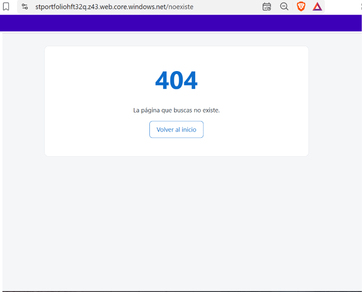

**Static website en el portal** (*Data management > Static website*): activado, con `index.html` y `404.html` configurados por Terraform:
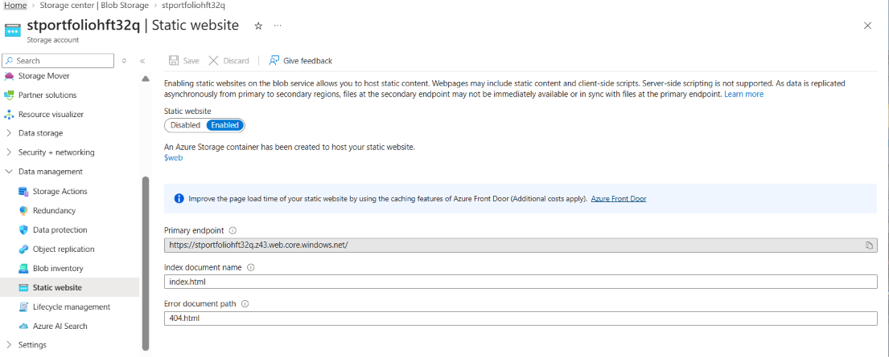

**Contenedor `$web`** con los 3 archivos subidos por Terraform como *Block blobs*:
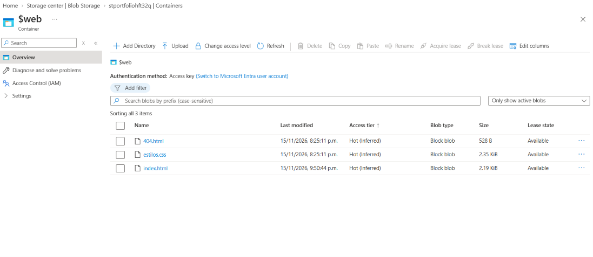

**`terraform state list`**: los 7 recursos que Terraform tiene registrados en el state:
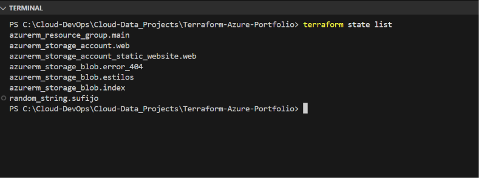

**Experimento A**: cambiar una etiqueta produce `~ update in-place` en el RG y la Storage, sin reemplazar nada:
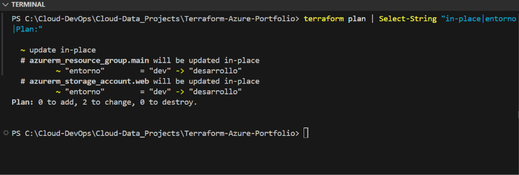

**Experimento C**: pasar de LRS a ZRS marca `# forces replacement`: se borraría la cuenta y se crearía otra (no se aplicó):
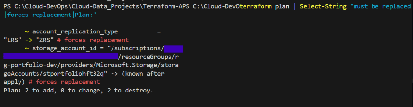

### Fase 2

**Refactorización sin cambios**: tras pasar a variables y locals, el plan solo añade los 3 outputs, *"without changing any real infrastructure"*:
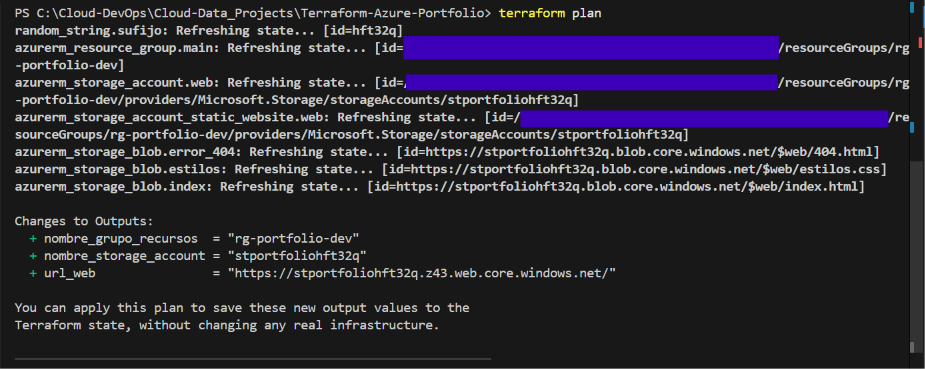

**`terraform output`**: el nombre del grupo de recursos, el de la Storage y la URL pública, sin buscarlos en el state:
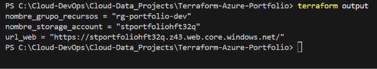

**Validación de variables**: `entorno = "produccion"` para el plan con el mensaje propio definido en `variables.tf`:
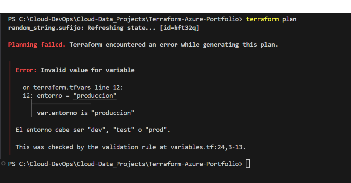

**`terraform console`**: evaluación de `local.etiquetas_comunes`, `local.nombre_grupo_recursos` y `upper(var.prefijo)` con los valores reales:
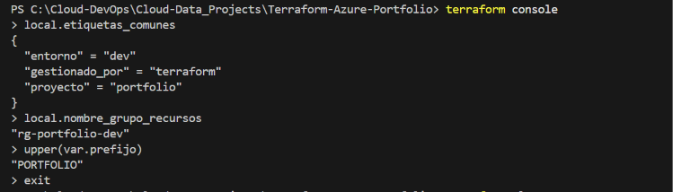

### Fase 3

**Bootstrap aplicado**: 5 recursos creados y los outputs que se copian en `backend.tf`:
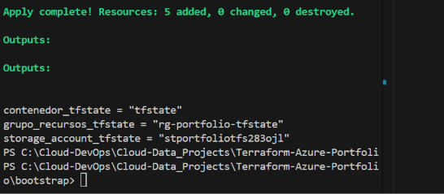

**Migración del state**: `terraform init -migrate-state` copia el state local al nuevo backend `azurerm`:
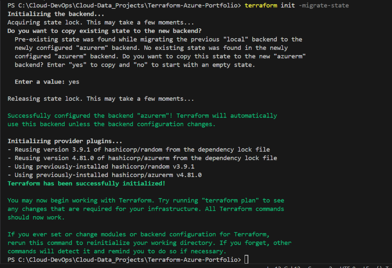

**Contenedor `tfstate`** con el blob `portfolio-dev.tfstate` en reposo (*Lease state: Available*):
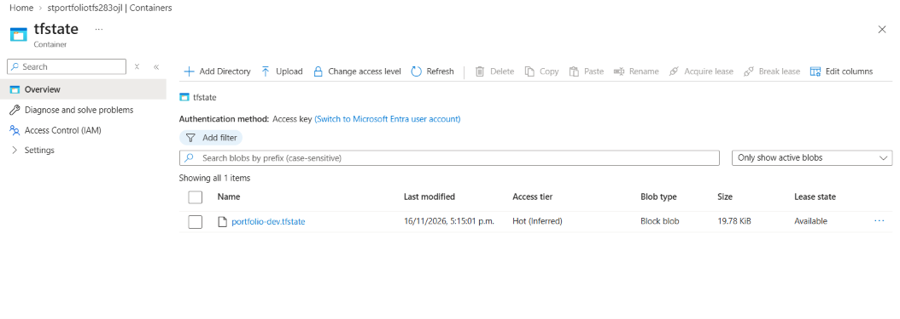

**State bloqueado** durante un `apply` pendiente de confirmación (*Lease state: Leased*):
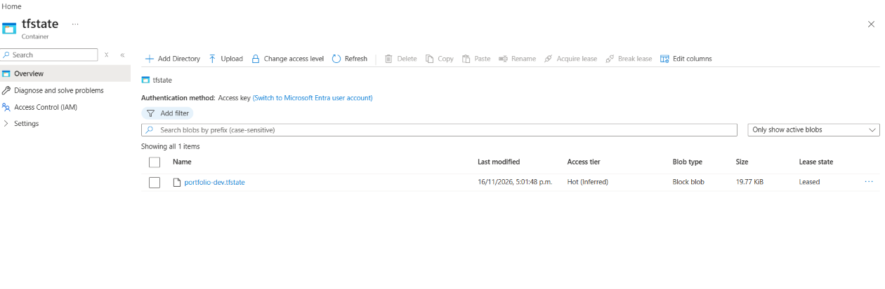

**Drift detectado**: el plan quiere quitar la tag manual, devolver `error_404_document` a `404.html` y recrear `index.html`:
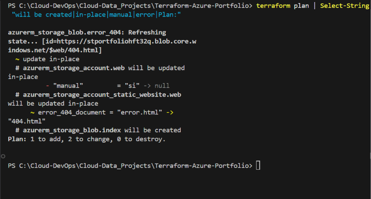

Ver [docs/capturas/LEEME.md](docs/capturas/LEEME.md) para las capturas pendientes de las siguientes fases.
